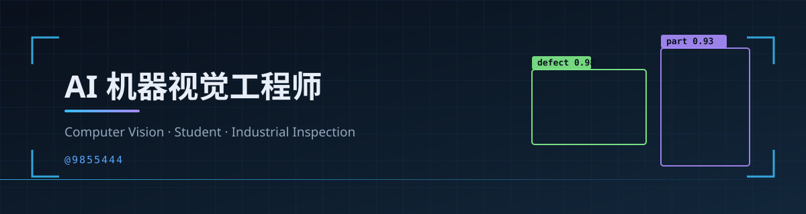

  

<h3 align="center">在校生 · 机器视觉方向 · 把课堂上的算法做成能跑起来的东西</h3>

  
  
  

---

## 关于我

我是 **AI 机器视觉方向的在校学生**，正在把「成像 → 算法 → 部署」这条链路系统地学一遍、做一遍。

- **在学**：深度学习基础、目标检测与分割、相机标定与 3D 视觉
- **在做**：课程项目、论文复现、工业缺陷检测的小型实验
- **在补**：C++ / CUDA 工程能力，以及模型量化与推理加速
- **目标**：毕业时能独立完成一个从数据到上线的视觉项目

> 先把一个项目做完整，再谈做很多个项目。

## 技术栈

| 类别 | 正在使用 |
| :--- | :--- |
| 语言 | `Python` · `C++`（学习中） · `CUDA`（入门） |
| 框架 | `PyTorch` · `OpenCV` · `Ultralytics` · `MMDetection` |
| 推理 | `ONNX Runtime` · `TensorRT`（入门） |
| 工程 | `Linux` · `Git` · `Docker` |
| 数据 | `Label Studio` · `CVAT` · `Albumentations` |

## 精选项目

<table>
  <tr>
    <td width="50%" valign="top">
      <h3><a href="https://github.com/cv-malin/cv-inspect-kit">cv-inspect-kit</a></h3>
      缺陷检测最小流水线：数据检查 → 按场景划分 → 训练 → 导出 ONNX → 推理测速。 
      <code>Python</code> · <code>ONNX</code> · <code>OpenCV</code>
    </td>
    <td width="50%" valign="top">
      <h3><a href="https://github.com/cv-malin/cv-notes">cv-notes</a></h3>
      机器视觉工程笔记：相机标定、模型部署、数据标注的实操要点与检查清单。 
      <code>Docs</code> · <code>Calibration</code> · <code>Deployment</code>
    </td>
  </tr>
  <tr>
    <td width="50%" valign="top">
      <h3><a href="https://github.com/cv-malin/trt-bench">trt-bench</a></h3>
      推理基准工具：延迟分位数、吞吐与精度对比，强调可复现的测量方法。 
      <code>Python</code> · <code>ONNXRuntime</code> · <code>TensorRT</code>
    </td>
    <td width="50%" valign="top">
      <h3><a href="https://github.com/cv-malin/neon-dodge">neon-dodge</a></h3>
      零依赖霓虹躲避小游戏：三档难度、每日挑战、道具磁吸与本地统计，擦身加分。 
      <code>JavaScript</code> · <code>Canvas</code> · <code>Daily</code>
    </td>
  </tr>
</table>

## 关注方向

<table>
  <tr>
    <td width="50%" valign="top">
      <b>🔍 工业缺陷检测</b> 
      小样本、少标注、极端长尾；表面缺陷与装配错漏检测。  
    </td>
    <td width="50%" valign="top">
      <b>🎯 检测与分割</b> 
      YOLO 系列、DETR 系列、SAM 系；实时性与精度的取舍。  
    </td>
  </tr>
  <tr>
    <td width="50%" valign="top">
      <b>📐 3D 视觉与标定</b> 
      相机标定、双目与结构光、点云配准、手眼标定。
    </td>
    <td width="50%" valign="top">
      <b>⚡ 模型部署优化</b> 
      量化与剪枝、TensorRT 引擎构建、多路视频流并发。
    </td>
  </tr>
</table>

## 阶段目标

- [x] 跑通第一个目标检测项目（数据标注 → 训练 → 推理）
- [x] 搭起可复用的检测流水线与笔记体系
- [ ] 完成一个完整的工业缺陷检测 demo，并整理成仓库
- [ ] 掌握 TensorRT 部署，把推理延迟压到实时

## GitHub 数据

  

  
  

## 联系

  
  

  持续学习中 · 欢迎交流机器视觉与部署实践

